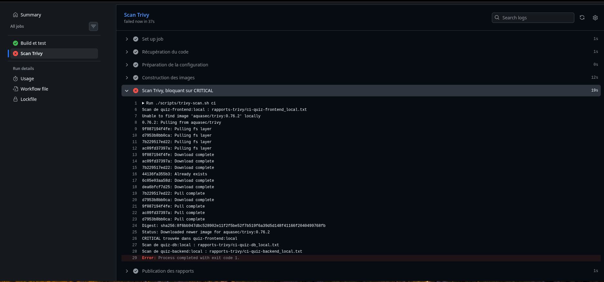
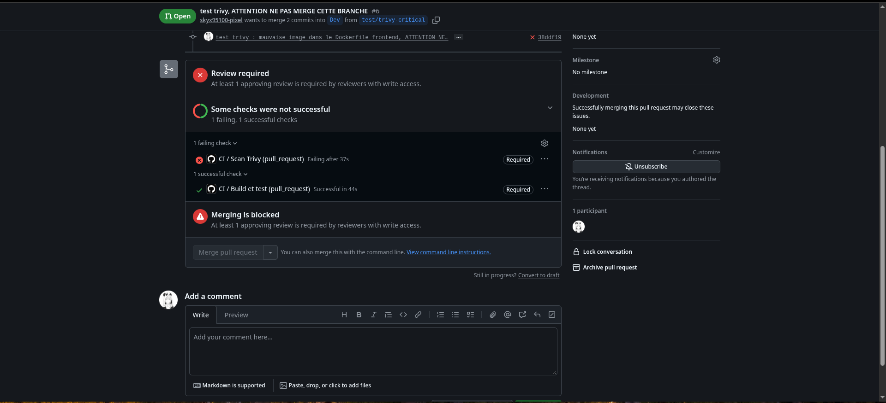
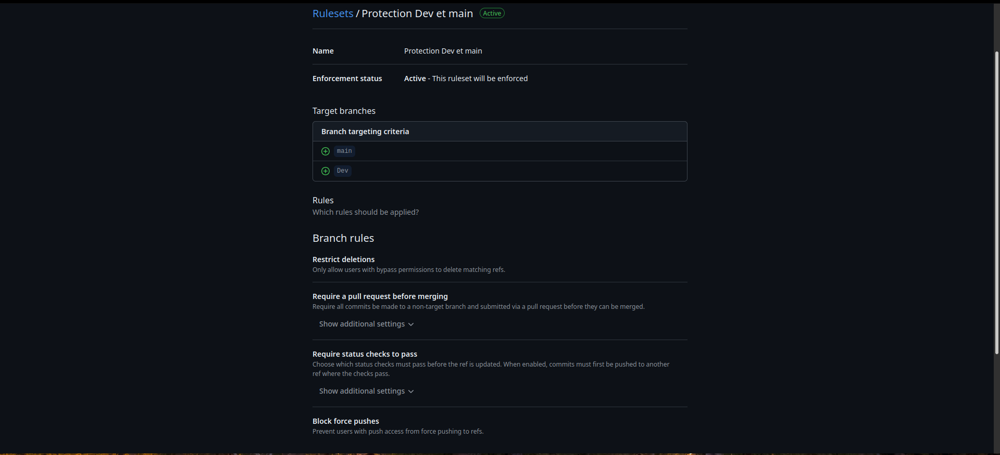
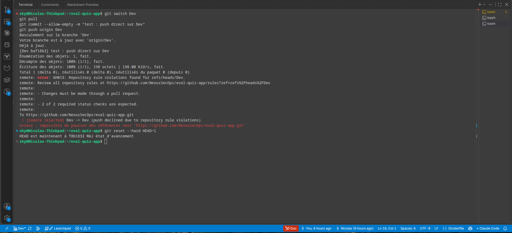

# J6-A : CI sur Pull Request

Date des preuves : 26 novembre 2026. Dépôt : https://github.com/NexusSecOps/eval-quiz-app

## État des exigences

| Exigence | État | Preuve |
|---|---|---|
| Build des images en CI | Fait | PR 5, job `Build et test` |
| Test de démarrage de la stack et de `/health` | Fait | PR 5, job `Build et test` |
| Scan Trivy bloquant sur CRITICAL | Démontré | PR 6, capture 01 |
| Contrôle réussi sur une PR saine | Fait | PR 5, run en succès |
| Checks obligatoires avant fusion | Fait | Ruleset actif, PR 6 bloquée, capture 02 |
| Revue et approbation obligatoires | Fait | Capture 02 : « Review required » bloque la PR 6. PR 7 : approuvée par `ERM-ops` (27 novembre 2026, 09:14 UTC), puis fusionnée. |

La protection de `Dev` et `main` est active depuis le 26 novembre 2026 : voir la section « Protection des branches ». Les PR 5 et 6 ont été ouvertes avant ou pendant sa mise en place, la PR 5 a donc été fusionnée sans approbation. La PR 7, ouverte après, a suivi le circuit complet.

## Fonctionnement

Le workflow `.github/workflows/ci.yml` se déclenche sur les Pull Requests vers `Dev` et `main`. Il contient deux jobs indépendants, qui sont les checks obligatoires avant fusion :

- `Build et test` : validation du Compose, construction des images, démarrage de la stack, puis test de `/health` via Nginx.
- `Scan Trivy` : construction des images, puis `scripts/trivy-scan.sh`, le même script que celui utilisé en local pour J2. Il lance Trivy avec `--severity CRITICAL --exit-code 1` : une seule CRITICAL fait sortir le script en code 1, donc échouer l'étape et le job. Il n'y a pas de `continue-on-error`.

Le workflow n'utilise aucun secret et ne pousse aucune image : il ne déploie rien. Le déploiement est prévu dans un workflow séparé, déclenché seulement après fusion dans `main` (J6-B).

## Démonstration contrôlée : le contrôle échoue

Une PR volontairement vulnérable, qui ne doit jamais être fusionnée, a été ouverte vers `Dev` :

- PR : https://github.com/NexusSecOps/eval-quiz-app/pull/6
- Branche : `test/trivy-critical`, commit `38ddf19`.
- Modification : dans le `Dockerfile` du frontend, `nginx:1.31-alpine` remplacée par `nginx:1.27-alpine`. Cette version repose sur un Alpine qui n'est plus supporté : 3 CRITICAL et 67 HIGH, voir `preuves/J2/avant-eval-quiz-app-frontend.txt`.
- Run : https://github.com/NexusSecOps/eval-quiz-app/actions/runs/45886061162
- Job `Scan Trivy` : https://github.com/NexusSecOps/eval-quiz-app/actions/runs/45886061162/job/140136930790

Résultat :

- `Build et test` : succès. L'image se construit et la stack démarre : l'échec ne vient donc pas d'une erreur de build.
- `Scan Trivy` : échec. Le log contient `CRITICAL trouvée dans quiz-frontend:local` puis `Process completed with exit code 1`.
- L'étape `Publication des rapports` s'exécute malgré l'échec : l'artefact `rapports-trivy` est disponible sur le run et contient le détail des vulnérabilités.
- Les rapports de ce run sont copiés dans [rapports-trivy/](rapports-trivy/). Le fichier `ci-quiz-frontend_local.txt` indique `Image : quiz-frontend:local (alpine 3.21.3)` et `Total: 70 (HIGH: 67, CRITICAL: 3)`, soit les mêmes chiffres que le scan local « avant » de J2 : la CI reproduit le résultat obtenu en local.



Précautions prises : aucune image n'est envoyée dans un registre (la CI ne s'authentifie sur aucun service), et cette PR ne doit jamais être fusionnée : elle sera fermée une fois les captures faites (voir la liste plus bas).

## Protection des branches Dev et main

La protection est un ruleset GitHub, créé avec l'API depuis la ligne de commande dans le dépôt du groupe :

```bash
gh api repos/NexusSecOps/eval-quiz-app/rulesets --method POST --input - <<'EOF'
{
  "name": "Protection Dev et main",
  "target": "branch",
  "enforcement": "active",
  "conditions": {
    "ref_name": { "include": ["refs/heads/main", "refs/heads/Dev"], "exclude": [] }
  },
  "bypass_actors": [],
  "rules": [
    { "type": "deletion" },
    { "type": "non_fast_forward" },
    {
      "type": "pull_request",
      "parameters": {
        "required_approving_review_count": 1,
        "dismiss_stale_reviews_on_push": false,
        "require_code_owner_review": false,
        "require_last_push_approval": false,
        "required_review_thread_resolution": false
      }
    },
    {
      "type": "required_status_checks",
      "parameters": {
        "strict_required_status_checks_policy": false,
        "required_status_checks": [
          { "context": "Build et test" },
          { "context": "Scan Trivy" }
        ]
      }
    }
  ]
}
EOF
```

Les noms des checks (`Build et test`, `Scan Trivy`) sont ceux réellement publiés par le workflow, relevés sur le premier run avant de créer la règle.

Ce que chaque règle impose, sur `Dev` et `main` :

| Règle | Effet |
|---|---|
| `deletion` | La branche ne peut pas être supprimée. |
| `non_fast_forward` | Le force push est interdit. |
| `pull_request`, 1 approbation | Aucune modification sans PR approuvée par une autre personne que l'auteur. |
| `required_status_checks` | Les deux checks doivent être verts avant la fusion. |
| `bypass_actors` vide | Personne ne peut contourner la règle, administrateurs compris. |

Choix assumé : `strict_required_status_checks_policy` est à `false`, une PR n'a pas besoin d'être à jour avec la branche cible pour fusionner. Cela évite de relancer la CI à chaque fusion d'une autre PR.

Vérification de la règle :

```bash
gh api repos/NexusSecOps/eval-quiz-app/rulesets --jq '.[] | {id, name, enforcement}'
gh pr view 6 --json mergeStateStatus,reviewDecision
```

Résultat observé le 26 novembre 2026 : ruleset `28191162` en `enforcement: active`, `current_user_can_bypass: never`, et pour la PR 6 `mergeStateStatus: BLOCKED` avec `reviewDecision: REVIEW_REQUIRED`.

La capture montre la PR 6 : `Scan Trivy` en échec et `Build et test` en succès, tous deux marqués « Required », la revue requise, et le bouton « Merge pull request » désactivé sous « Merging is blocked ».



La page du ruleset dans les paramètres du dépôt montre qu'il est actif (`Active`), qu'il cible `main` et `Dev`, et la liste des règles : suppression restreinte, PR obligatoire, checks obligatoires, force push bloqué.



### Test d'un push direct sur Dev

Un commit vide a été créé sur `Dev` en local, puis poussé directement, sans passer par une PR et sans forcer. GitHub l'a refusé :

```text
$ git commit --allow-empty -m "test : push direct sur Dev"
[Dev baf18b2] test : push direct sur Dev
$ git push origin Dev
remote: error: GH013: Repository rule violations found for refs/heads/Dev.
remote: Review all repository rules at https://github.com/NexusSecOps/eval-quiz-app/rules?ref=refs%2Fheads%2FDev
remote:
remote: - Changes must be made through a pull request.
remote:
remote: - 2 of 2 required status checks are expected.
remote:
 ! [remote rejected] Dev -> Dev (push declined due to repository rule violations)
$ git reset --hard HEAD~1
HEAD est maintenant à f8b1832 MàJ état d'avancement
```

Les deux motifs du refus correspondent aux règles du ruleset : passage obligatoire par une PR, et checks `Build et test` et `Scan Trivy` requis.



Avant le test, la branche locale était à jour avec `origin/Dev` : le refus vient bien de la règle et non d'un retard de la branche. Le commit de test n'a jamais atteint le dépôt distant et a été supprimé en local avec le `git reset --hard HEAD~1` visible ci-dessus.

## Démonstration : le contrôle réussit

La PR 5 (`J6-A : CI sur Pull Request`) a passé les deux checks, `Build et test` et `Scan Trivy`, avec des images sans HIGH ni CRITICAL, voir `preuves/J2/README.md`.

- PR : https://github.com/NexusSecOps/eval-quiz-app/pull/5
- Run : https://github.com/NexusSecOps/eval-quiz-app/actions/runs/45846084821

Cette PR a été fusionnée avant l'activation de la protection : elle ne comporte donc pas d'approbation.

Avec la protection active, la PR 7 (`J4 : frontend et backend sur Azure Container Apps`) a suivi le circuit complet :

- PR : https://github.com/NexusSecOps/eval-quiz-app/pull/7
- Run : https://github.com/NexusSecOps/eval-quiz-app/actions/runs/45970668454, `Build et test` et `Scan Trivy` en succès.
- Revue : approuvée par `ERM-ops`, un autre membre que l'auteur de la PR (`skyx95100-pixel`), avant la fusion dans `Dev`.
- Tant qu'aucune approbation n'existait, la fusion était bloquée (`mergeStateStatus: BLOCKED`, `reviewDecision: REVIEW_REQUIRED`), checks verts compris.

## Reste à produire

- [ ] Fermer la PR 6 sans la fusionner et supprimer la branche `test/trivy-critical`.
- [x] Activer la protection de `Dev` et `main` : voir « Protection des branches ».
- [x] Capture 02 : fusion bloquée sur une PR dont le scan échoue.
- [x] Rapport Trivy de l'artefact, avec les 3 CRITICAL : fichiers dans `rapports-trivy/`.
- [ ] Capture 04 : PR 7 avec les deux checks verts et l'approbation (à prendre depuis la page de la PR).
- [x] Capture 05 : règle de protection active dans les paramètres du dépôt.
- [x] Capture 06 : push direct refusé sur `Dev`.
